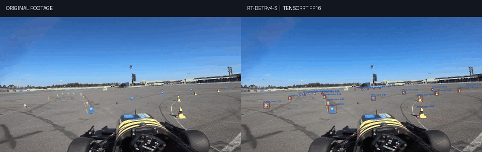

# Real-Time Cone Detection with RT-DETRv4

Real-time Formula Student cone detection trained on FSOCO. This project fine-tunes RT-DETRv4-S with an HGNetv2 backbone and DINOv3 teacher distillation, then deploys the detector as a TensorRT FP16 engine.

## Demo

The comparison below shows the source footage beside the TensorRT detections. The annotated video is also available as [MP4](RT-DETRv4/outputs/rtv4_hgnetv2_s_fsoco/video_predictions/rtdetrv4_s_fsoco_trt_skidpad_showcase.mp4).



Source footage: [“Formula Student Germany Driverless Skidpad” by KA-RaceIng e.V.](https://www.youtube.com/watch?v=Fs6a0Aqu4YA).

## Results

| Evaluation | Result |
|---|---:|
| Classes | 5 cone classes |
| Input resolution | 640 × 640 |
| Precision | 0.734 |
| Recall | 0.886 |
| mAP@0.50 | 0.734 |
| mAP@0.50:0.95 | 0.484 |
| TensorRT FP16 inference throughput | 141.9 FPS |
| Effective video benchmark throughput | 106.6 FPS |
| Effective showcase throughput (decode, draw, and write video) | 54.6 FPS |

The FPS numbers come from the saved runs on an RTX 5060 Laptop GPU. The throughput benchmark does not draw boxes or encode a video; the showcase rate includes video decoding, annotation, and MP4 writing. Both used the 1920 × 1080, 59.94 FPS skidpad footage and a confidence threshold of 0.40. See the [benchmark summaries](RT-DETRv4/outputs/rtv4_hgnetv2_s_fsoco/video_predictions/).

## Model and classes

The detector recognizes:

1. `yellow_cone`
2. `blue_cone`
3. `orange_cone`
4. `large_orange_cone`
5. `unknown_cone`

The final checkpoint, ONNX export (including its external data file), and Linux TensorRT FP16 engine are in `RT-DETRv4/outputs/rtv4_hgnetv2_s_fsoco/`. The engine is hardware- and TensorRT-version-specific; rebuild it on the target machine.

## Train on FSOCO

The dataset is not included. Place an FSOCO export in YOLO detection format:

```text
data/fsoco_yolo/
├── data.yaml
├── images/
│   ├── train/
│   ├── val/
│   └── test/
└── labels/
    ├── train/
    ├── val/
    └── test/
```

`data.yaml` must provide the five class names in the order listed above. Convert the dataset to the COCO layout expected by the training config:

```bash
python scripts/yolo_to_coco.py
```

Install the RT-DETRv4 requirements in a Python 3.11 environment with a PyTorch build compatible with your CUDA setup:

```bash
python -m pip install -r RT-DETRv4/requirements.txt
```

The training config expects the DINOv3 teacher weights at `RT-DETRv4/pretrain/dinov3_vitb16_pretrain_lvd1689m.pth` and the HGNetv2 pretrained weights under `RT-DETRv4/pretrain/hgnetv2/`. These large pretrained files and the dataset are not tracked; obtain them from their respective upstream projects and place them at those paths.

Run training from the repository root:

```bash
cd RT-DETRv4
python train.py -c configs/rtv4/rtv4_hgnetv2_s_fsoco.yml --use-amp --seed=0
```

The trained model is written to `RT-DETRv4/outputs/rtv4_hgnetv2_s_fsoco/`.

## Run the TensorRT video demo

Use Linux with a compatible NVIDIA GPU, CUDA, and TensorRT. Install OpenCV and PyTorch in the same environment. To rebuild the engine from the included ONNX export on the target GPU:

```bash
cd RT-DETRv4
python ../scripts/build_trt_engine.py
cd ..
python scripts/predict_video_trt_showcase.py
```

The showcase reads `videos/Formula Student Germany Driverless Skidpad.mp4` and writes the annotated output and a CSV summary to `RT-DETRv4/outputs/rtv4_hgnetv2_s_fsoco/video_predictions/`.

The repository uses Git LFS for model weights, ONNX exports, TensorRT engines, and videos. Install Git LFS before cloning or pulling the large files:

```bash
git lfs install
git lfs pull
```

## Repository layout

```text
RT-DETRv4/
├── configs/rtv4/rtv4_hgnetv2_s_fsoco.yml  # FSOCO training config
├── dinov3/                                 # Teacher model source
├── engine/                                 # RT-DETRv4 implementation
└── outputs/rtv4_hgnetv2_s_fsoco/           # Final model and demo artifacts
scripts/
├── build_trt_engine.py
├── predict_video_trt_showcase.py
└── yolo_to_coco.py
videos/                                     # Source demo clip
```

## Licenses and attribution

This project's original code is licensed under the [MIT License](LICENSE). Vendored RT-DETRv4 code is covered by its [upstream Apache-2.0 license](RT-DETRv4/LICENSE); DINOv3 materials are subject to Meta's [DINOv3 license](RT-DETRv4/dinov3/LICENSE.md). Those third-party terms remain in effect for their respective materials.


